  

  
  
  

## Hakkımda

Yazılım geliştiriciyim. Bir işi **tasarımından koduna, sunucu kurulumundan yayına alınmasına kadar** baştan sona üstlenirim. Tek bir kişiyle konuşursun, iş eksiksiz teslim edilir.

- 💻 Web uygulamaları, yönetim panelleri, **Lua** ile uygulama ve oyun geliştirme
- 🎙️ Sesi yazıya çeviren **Speech to Text** sistemleri
- ☎️ **Çağrı merkezi** kurulumu ve yönetimi: IP santral, IVR, SIP trunk
- 🛡️ Sunucu kurulumu, **kabin taşıma**, helpdesk ve **güvenlik açığı** giderme
- 🎨 Logo, kurumsal kimlik ve arayüz tasarımı

Önce problemi anlarım, sonra kodu yazarım. Okunabilir kod, küçük ama sık teslimler ve düzgün dokümantasyonla çalışırım.

 

## Neler yapıyorum

<table>
  <tr>
    <td width="33%" valign="top">
      <h3>💻 Yazılım</h3>
      Web siteleri ve uygulamalar, satış / stok panelleri, Lua ile uygulama ve oyun, Speech to Text, API entegrasyonları.
    </td>
    <td width="33%" valign="top">
      <h3>🖥️ Altyapı</h3>
      Linux &amp; Windows Server, site ve fiziksel kabin taşıma, çağrı merkezi (IVR, SIP trunk), helpdesk, güvenlik ve yedekleme.
    </td>
    <td width="33%" valign="top">
      <h3>🎨 Tasarım</h3>
      Logo tasarımı ve güncelleme, kurumsal kimlik, renk ve tipografi, web ve mobil arayüz tasarımı.
    </td>
  </tr>
</table>

## Araç kutum

**Yazılım** 

**Altyapı** 

**Tasarım** 

## Öne çıkan işler

| Proje | Ne yaptım |
| --- | --- |
| 🎙️ [**Speech To Text**](https://dev.huso.com.tr/tr/projects/speech-to-text) | Ses kayıtlarını ve canlı konuşmayı aranabilir metne çeviren konuşma tanıma sistemi |
| ☎️ [**Çağrı Merkezi Kurulumu**](https://dev.huso.com.tr/tr/projects/cagri-merkezi) | IVR menüleri, SIP trunk hatları ve çağrı kuyruklarıyla uçtan uca santral kurulumu ve yönetimi |
| 🛡️ [**Site Güvenlik Açıkları**](https://dev.huso.com.tr/tr/projects/guvenlik-acigi-giderme) | Güvenlik taraması, açıkların önceliklendirilip kapatılması ve sunucu sıkılaştırma |
| 🗄️ [**Fiziksel Kabin Taşıma**](https://dev.huso.com.tr/tr/projects/kabin-sunucu-tasima) | Kabindeki sunucuların planlı ve veri kaybı olmadan yeni veri merkezine taşınması |
| 🚗 [**Oto Tamirci Paneli**](https://dev.huso.com.tr/tr/projects/oto-servis-paneli) | Parça stoğu, satış ve servis kayıtlarını tek ekranda toplayan web paneli |
| 🎮 [**Lua ile Oyun**](https://dev.huso.com.tr/tr/projects/lua-oyun) | Oyun mekanikleri, ekonomi, veri kaydı ve oyun arayüzleri |

➡️ Tüm projeler ve detayları: **[dev.huso.com.tr/tr/projects](https://dev.huso.com.tr/tr/projects)**

## Birlikte çalışalım

Aklında bir proje, yarım kalmış bir iş ya da taşınması gereken bir sunucu mu var?

- 🌐 **Site:** [dev.huso.com.tr](https://dev.huso.com.tr)
- ✉️ **E-posta:** [info@huso.com.tr](mailto:info@huso.com.tr)

Genelde aynı gün dönüş yaparım.

 

---

🇬🇧 <b>English</b>

 

I'm a software developer who takes projects **from design and code to server setup and launch**. You talk to one person and get the whole thing delivered.

- 💻 Web apps, dashboards, app and game development with **Lua**
- 🎙️ **Speech to Text** systems that turn audio into searchable text
- ☎️ **Call center** setup and management: IP PBX, IVR, SIP trunks
- 🛡️ Server setup, **physical rack migrations**, helpdesk and **security hardening**
- 🎨 Logos, brand identity and interface design

Portfolio: **[dev.huso.com.tr/en](https://dev.huso.com.tr/en)** · Email: **[info@huso.com.tr](mailto:info@huso.com.tr)**

